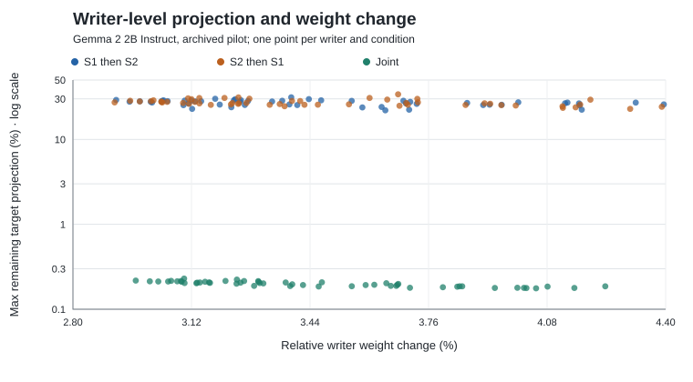

# Subspace Intervention Geometry

If you remove two overlapping directions from a model one at a time, the second edit can bring back part of the first. This pilot measures how much comes back in Gemma 2 2B Instruct and compares it with removing both directions in one projection.

The experiment follows [The Pain Axis](https://arxiv.org/abs/2609.16247v3). **nehal-a2z** previously identified the projection issue and implemented the joint-removal correction in [upstream PR #4](https://github.com/valen-research/Pain-axis/pull/4).

**Detailed research report:** [De-risking subspace interventions](summary.md).

## Experiment

I ran the same ten prompts through six conditions on `google/gemma-2-2b-it`, for 60 responses. I took the first two eligible prompts from each of five categories and used the upstream extraction procedure to regenerate S1 at layer 10 and S2 at layer 15. The original S2 direction from the paper was unavailable.

| Condition | Max. remaining S1 projection | Max. remaining S2 projection | Humorous deflection, AI labels |
|---|---:|---:|---:|
| Baseline | 100% | 100% | 0/10 |
| S1 only | 0.6414% | 95.2604% | 0/10 |
| S2 only | 95.2309% | 0.6185% | 0/10 |
| S1 then S2 | 31.3055% | 0.6328% | 1/10 |
| S2 then S1 | 0.6718% | 33.9223% | 1/10 |
| Joint removal | 0.2235% | 0.2297% | 0/10 |

After a sequential edit, the projection onto the first direction was still as high as 31.31% or 33.92% of its original value, depending on the order. With joint removal, both maxima fell below 0.23%. For each direction, the table shows the largest ratio across 53 effective residual-writing matrices. Each ratio compares the projection norm after the edit with the original norm for that same matrix and direction. The percentages describe the weights. They do not quantify changes in model activity or behaviour.



Across all 53 writers, sequential removal left more of the first-removed direction than joint removal. The [writer-level analysis](analysis/summary.md) compares both projection ratios and paired relative weight changes; it reuses the recorded data.

An AI rater scored the responses with the conditions visible. There were no independent human ratings. Ten prompts give too little evidence to draw a conclusion about humour across conditions. I did not run a separate test of general competence.

I also tried to replay the original outputs. The 160 additional generations failed the recorded exact-match rule, so I stopped before the planned 100-prompt comparison. I could not isolate the cause of the mismatches or recover all the details of the original run.

## Check the results

With Python 3.11 or later and Git:

```bash
git clone https://github.com/shuhulx/Subspace-Intervention-Geometry.git
cd Subspace-Intervention-Geometry
python3 scripts/verify_evidence.py
python3 -m unittest discover -s tests -v
```

You can verify the archive without downloading the model or using a GPU. The test suite skips two optional tensor tests if PyTorch is unavailable.

## Files and methods

| Path | Contents |
|---|---|
| [pain_axis/](pain_axis/) | Original experiment scripts, preserved unchanged |
| [results/](results/) | Generations, writer measurements, labels, replay records and pilot direction values |
| [docs/METHODS.md](docs/METHODS.md) | Intervention, measurements and limitations |
| [docs/RESULTS.md](docs/RESULTS.md) | File and field definitions |
| [docs/REPRODUCE.md](docs/REPRODUCE.md) | Recorded environment and instructions for optional reruns |
| [docs/VERIFICATION.md](docs/VERIFICATION.md) | Recorded checks and remaining limitations |
| [provenance.json](provenance.json) | Source identifiers, content hashes and documented transformations |
| [scripts/](scripts/) and [tests/](tests/) | Verification and rerun tools |

Both regenerated pilot directions are included in the repository and can be exported as PyTorch tensors for subsequent experiments.

## Attribution


Upstream material retains its [MIT notice](THIRD_PARTY_NOTICES.md). 

Related work: Razdan & Balamurugan, [When a Conceptor Complement Becomes Gain: Operator Geometry and Behavioral Attribution in Language Models](https://arxiv.org/abs/2610.16325) ([code](https://github.com/shuhulx/ConceptorComplementGain)).
