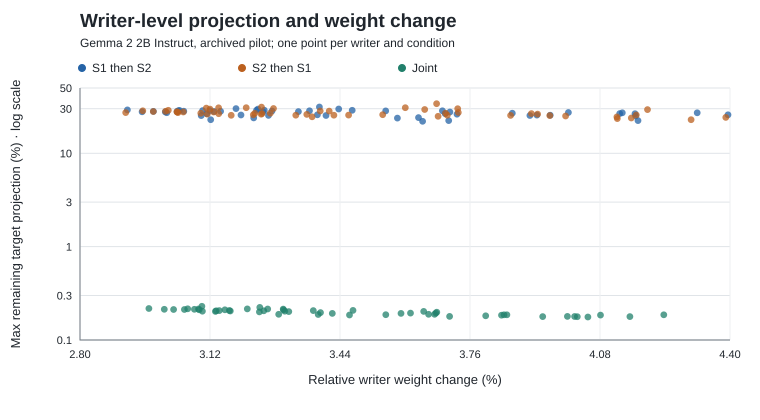

# Writer-level geometry

Reanalysis of the archived Gemma 2 2B Instruct pilot. No new model runs.

Each row below aggregates 53 effective residual-writing matrices. Directional ratios use the original norm for the same writer and direction. Weight changes use each original writer's Frobenius norm.

| Condition | Median S1 remaining | Max S1 remaining | Median S2 remaining | Max S2 remaining | Mean weight change |
|---|---:|---:|---:|---:|---:|
| S1 then S2 | 27.357% | 31.305% | 0.528% | 0.633% | 3.469% |
| S2 then S1 | 0.542% | 0.672% | 26.833% | 33.922% | 3.470% |
| Joint | 0.193% | 0.223% | 0.194% | 0.230% | 3.460% |

## Paired comparison

- S1 then S2: the first-removed direction has a larger remaining projection than joint removal in 53/53 writers. The paired difference in relative weight change (sequential minus joint) ranges from -0.066 to +0.166 percentage points, with mean +0.010.
- S2 then S1: the first-removed direction has a larger remaining projection than joint removal in 53/53 writers. The paired difference in relative weight change (sequential minus joint) ranges from -0.070 to +0.153 percentage points, with mean +0.010.

Each point represents one writer under one condition. Similar weight changes do not establish matched activation distortion or behavioural effects. The writers are parts of a single checkpoint, not independent model replications. The pilot uses regenerated directions and the previously published upstream joint-projection correction.

Reproduce from the repository root: `python3 analysis/writer_geometry.py`.
