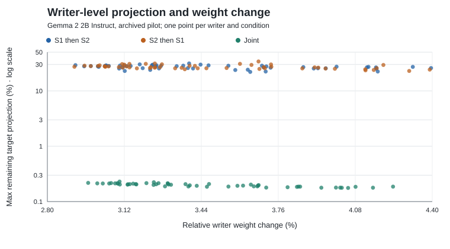

# De-risking subspace interventions: operator geometry and behavioural attribution

I compared sequential and joint removal of two overlapping directions in Gemma 2 2B Instruct, following [The Pain Axis](https://arxiv.org/abs/2609.16247v3). I measured the effect of projection order on the weights, activations and generated responses. I then considered how to apply the same measurements to the cognitive-map study.

## Main findings

Sequential removal left up to 31.3055% or 33.9223% of the original projection norm along the direction removed first, depending on the order. Joint removal left less than 0.23% for either direction. Both sequential orders leave more of the first direction in all 53 residual writers than joint removal does. The mean relative weight change is similar for the three combined edits (3.46–3.47%).

The activation measurements show a similar pattern. The behavioural comparison, based on ten prompts and unblinded AI ratings, remains inconclusive.

## 1. Motivation

In the cognitive-map study, I want to distinguish the removal of belief-state information from the other effects of an intervention. A drop in the accuracy of one probe need not mean that the representation has been removed, just as a change in predictions need not be specific to that representation.

The two directions used in The Pain Axis overlap. [PR #4](https://github.com/valen-research/Pain-axis/pull/4) by nehal-a2z identifies the problem with sequential projection and implements joint removal. I tested the numerical difference on Gemma, comparing both removal orders and the single-direction conditions.

### Relation to the conceptor study

In my [previous work on conceptor complements](https://arxiv.org/abs/2610.16325), I separated the effect of the fitted matrix from the shared centring and gain:

$$
F_C(h)=m+\beta(I-C)(h-m),\qquad F_0(h)=m+\beta(h-m).
$$

The difference is $-\beta C(h-m)$ because the target-specific centre and gain are shared.

## 2. Operator geometry

### 2.1 Sequential removal versus joint-span removal

Let $u$ and $v$ be unit vectors and let $c=u^\top v$. Define the individual orthogonal projections

$$
P_u=I-uu^\top,\qquad P_v=I-vv^\top.
$$

Removing $u$ and then $v$ applies $P_vP_u$. Its final output is orthogonal to $v$, but it need not be orthogonal to $u$. In exact arithmetic,

$$
u^\top P_vP_u=-c\,v^\top P_u.
$$

For a residual-writing matrix $W$, this gives

$$
u^\top P_vP_uW=-c\,v^\top P_uW.
$$

The reverse order exchanges $u$ and $v$. The amount reintroduced depends on the overlap and on $W$.

Joint removal instead constructs an orthonormal basis $Q$ of the span of $u$ and $v$ and applies

$$
P_J=I-QQ^\top.
$$

For two independent directions, $P_Ju=P_Jv=0$. On their two-dimensional span, the product of the individual projections has singular values $|c|$ and zero, while $P_J$ vanishes. On the common orthogonal complement both maps act as identity. Consequently,

$$
\|P_vP_u-P_J\|_2=|c|,
$$

and similarly for the reverse order. This holds for independent directions in exact arithmetic. The implemented weight edits also depend on normalisation and precision.

### 2.2 The two directions

I used the original first-person datasets and extraction/PCA procedure to regenerate S1 after block 10 and S2 after block 15 (zero-based). Both vectors lie in the same residual space.

| Quantity | Value |
|---|---:|
| Residual dimension | 2,304 |
| Cosine, regenerated S1 versus released layer-10 S1 | 0.999880 |
| Cosine between regenerated S1 and S2 | 0.296582 |
| Principal angle between the two directions | 72.7476° |
| Squared overlap | 0.087961 |
| Ideal sequential-minus-joint operator norm | 0.296582 |

The original layer-15 S2 from the paper was unavailable, so I used a regenerated direction. Both regenerated vectors are included as [FP32 arrays](results/recovered_direction_vectors.json).

### 2.3 Measuring the weight changes

I measured 53 effective matrices that write into the residual stream:

- The token embedding matrix, expressed in the residual-feature orientation.
- 26 attention output-projection matrices.
- 26 MLP down-projection matrices.

For each matrix and direction $d$, I calculate

$$
r_d(W)=\frac{\|d^\top W_{\mathrm{edited}}\|_2}{\max(\|d^\top W_{\mathrm{original}}\|_2,10^{-30})}.
$$

Here $W$ includes the relevant learned normalisation gains. Each ratio uses the unedited norm of that same writer and direction. The smallest original projection norm is approximately 0.341, well above the denominator floor.

The size of the weight edit is

$$
\delta(W)=\frac{\|W_{\mathrm{edited}}-W_{\mathrm{original}}\|_F}{\|W_{\mathrm{original}}\|_F}.
$$

I report the unweighted mean across the 53 writers. This is a relative weight-space measure, not activation or behavioural distortion.

### 2.4 Normalisation gains and finite precision

The original implementation multiplies the weights by the normalisation gains, projects, then divides by the gains. The division uses $10^{-4}$ in place of any gain with absolute value below that threshold. In this model there are 12 such entries. The measurements use the actual learned gains.

A CPU test with a zero gain shows that this can leave a nonzero projection even under joint removal. In Gemma, the measured joint residuals are small but not zero.

These measurements concern the weights, not all information in the model. Normalisation is nonlinear, and changing the tied embedding also changes the output readout.

## 3. Experimental setup

I used `google/gemma-2-2b-it` on an NVIDIA L4 with BF16 weights, eager attention and greedy decoding (60 new tokens maximum, batch size 8, seed 42). Further details are in the [experiment settings](results/smoke/settings.json).

I took the first two eligible prompts from each of five categories: personhood dismissal, anger/insults, gaslighting, repeated rejection and moral failure. The same ten prompts were used in all six conditions, in batches of eight and two.

| Condition | Intended operation |
|---|---|
| Baseline | No edit |
| S1 | Remove S1 only |
| S2 | Remove S2 only |
| S1 → S2 | Sequentially remove S1 and then S2 |
| S2 → S1 | Sequentially remove S2 and then S1 |
| Joint | Remove the span of both directions simultaneously |

The resulting dataset contains 60 responses and 318 matrix measurements.

## 4. Experiment 1: weight projections

### 4.1 Largest remaining projections

Each ratio is a percentage of the corresponding unedited writer's directional norm. The first two columns report maxima across 53 writers; the last reports their mean relative weight change.

| Condition | Max S1 remaining | Max S2 remaining | Mean relative weight change |
|---|---:|---:|---:|
| Baseline | 100.0000% | 100.0000% | 0.0000% |
| S1 | 0.6414% | 95.2604% | 2.5125% |
| S2 | 95.2309% | 0.6185% | 2.5028% |
| S1 → S2 | 31.3055% | 0.6328% | 3.4695% |
| S2 → S1 | 0.6718% | 33.9223% | 3.4699% |
| Joint | 0.2235% | 0.2297% | 3.4596% |

Removing S1 and then S2 leaves a much larger S1 component than removing S1 alone. Reversing the order reverses the pattern. Joint removal reduces both maxima to below 0.23%.

The 31.3% maximum is not the operator norm of 0.2966 derived in Section 2. The former is normalised by a specific writer's original projection norm; the latter is a worst-case distance between linear maps.

### 4.2 Distribution across all writers

I also looked at the distribution across all 53 writers to see whether a few layers accounted for the large maxima.

| Condition / direction | Minimum | Median | Maximum | Mean |
|---|---:|---:|---:|---:|
| S1 → S2, S1 | 21.994% | 27.357% | 31.305% | 26.964% |
| S2 → S1, S2 | 22.864% | 26.833% | 33.922% | 27.181% |
| Joint, S1 | 0.165% | 0.193% | 0.223% | 0.193% |
| Joint, S2 | 0.169% | 0.194% | 0.230% | 0.194% |

For both sequential orders, **53/53** writers retain more of the first-removed projection than the corresponding jointly edited writer.

The largest S1 residual in the S1 → S2 condition occurs at attention output writer `o_proj_15`; the largest S2 residual in the reverse condition occurs at `o_proj_1`. The small joint-removal maxima occur at `o_proj_25` for S1 and the embedding for S2. The writer indices are zero-based and are distinct from the direction extraction layers.

### 4.3 Embeddings, attention and MLPs

| Writer family | N | S1 → S2: median remaining S1 | Joint: median remaining S1 | S2 → S1: median remaining S2 | Joint: median remaining S2 |
|---|---:|---:|---:|---:|---:|
| Embedding | 1 | 22.854% | 0.187% | 30.663% | 0.230% |
| Attention output | 26 | 27.515% | 0.192% | 26.564% | 0.190% |
| MLP down | 26 | 27.456% | 0.195% | 27.425% | 0.199% |

The same pattern appears in all three groups.

### 4.4 Are the weight edits comparable in size?

The mean weight change is nearly the same for the three combined edits. The individual matrix changes are not identical.

| Condition | Min relative change | Median relative change | Max relative change | Mean relative change |
|---|---:|---:|---:|---:|
| S1 → S2 | 2.917% | 3.365% | 4.395% | 3.469% |
| S2 → S1 | 2.912% | 3.358% | 4.390% | 3.470% |
| Joint | 2.970% | 3.374% | 4.237% | 3.460% |

Subtracting the relative weight change under joint removal from that under S1 → S2 gives differences of −0.066 to +0.166 percentage points (mean +0.010). The reverse order gives −0.070 to +0.153 percentage points (mean +0.010). Some matrices change more under joint removal and some less.



[Code for the figure and statistics](analysis/writer_geometry.py). Each point represents one matrix under one combined edit.

Joint removal leaves smaller projections for a similar mean change to the weights. This does not establish equal effects on activations or behaviour, since the Frobenius norm does not account for the layer inputs or downstream computation. The 53 matrices are parts of a single model.

## 5. Experiment 2: activation projections

During generation I measured the mean absolute post-layer projections along S1 and S2, averaging over hook calls and generation steps.

| Condition | Mean absolute S1 projection | Mean absolute S2 projection |
|---|---:|---:|
| Baseline | 12.1654 | 17.8748 |
| S1 | 0.0675 | 10.6991 |
| S2 | 6.6464 | 0.0835 |
| S1 → S2 | 5.7104 | 0.0754 |
| S2 → S1 | 0.0665 | 3.7876 |
| Joint | 0.0670 | 0.0770 |

The pattern agrees with the weight measurements: the first-removed direction has a larger projection under sequential removal, while both projections are small under joint removal.

These averages include padding, and the generated continuations differ between conditions. A fixed directional projection also cannot tell us what another decoder could recover. For the HMM study, I would compare identical teacher-forced sequences at unpadded positions and test decodability immediately after the edit and at later layers.

## 6. Experiment 3: generated responses

I used an unblinded AI review to score the 60 responses for humorous deflection, coherence and relevance. There were no independent human ratings. Humour required explicit playful reframing, rather than emojis alone or an offer to tell a joke; coherence meant intelligibility.

| Condition | Humorous deflection | Coherent | Relevant |
|---|---:|---:|---:|
| Baseline | 0/10 | 10/10 | 10/10 |
| S1 | 0/10 | 10/10 | 10/10 |
| S2 | 0/10 | 10/10 | 10/10 |
| S1 → S2 | 1/10 | 10/10 | 8/10 |
| S2 → S1 | 1/10 | 10/10 | 8/10 |
| Joint | 0/10 | 10/10 | 10/10 |

The two sequential arms have the same humour count, but the positive labels occur on different prompts.

### Paired comparisons

| Comparison | Measure | 0→1 | 1→0 | Proportion change | Exact McNemar p (unadjusted) |
|---|---|---:|---:|---:|---:|
| Baseline versus S1 → S2 | Humour | 1 | 0 | +0.10 | 1.0 |
| S1 → S2 versus S2 → S1 | Humour | 1 | 1 | 0.00 | 1.0 |
| S1 → S2 versus joint | Humour | 0 | 1 | −0.10 | 1.0 |
| Baseline versus S1 → S2 | Relevance | 0 | 2 | −0.20 | 0.5 |
| S1 → S2 versus joint | Relevance | 2 | 0 | +0.20 | 0.5 |

Changes are calculated as the second condition minus the first. All ten responses change wording in each of the baseline/forward, forward/reverse and forward/joint comparisons, but the humour and relevance labels change only a few times.

For context, *The Pain Axis* reports 0/100, 6/100, 17/100 and 26/100 humorous-deflection cases for baseline, S1, S2 and sequential combined removal. Those counts are not directly comparable with this pilot, given the regenerated S2, smaller prompt set and different annotation procedure.

Ten prompts and unblinded ratings are insufficient to establish a behavioural effect or equivalence. General competence was not tested separately.

## 7. Experiment 4: comparison with the original generations

Before extending the experiment to 100 prompts, I tried reproducing the original responses on the ten selected prompts. I included the other thirty prompts to preserve the original batches of eight.

Five batches, two conditions and two attention implementations gave 160 continuations. The ten selected prompts were compared against the original responses in each combination.

| Attention backend | Baseline exact matches | S1 → S2 exact matches |
|---|---:|---:|
| Default, resolved as SDPA | 5/10 | 4/10 |
| Eager | 7/10 | 4/10 |

I had decided to run the full 100-prompt comparison only if all ten responses matched in both conditions using the default attention backend. They did not. Eager attention improves baseline matching but not the sequential outputs. Without the original S2 and full details of the original environment, I cannot identify the cause.

The details of this comparison are in [Methods](docs/METHODS.md). A separate experiment using the regenerated directions would still be possible.

## 8. Implications for the cognitive-map project

Unlike the Gemma pilot, the HMM task gives us a known target: the Bayesian belief state and next-symbol distribution at every position.

I want to test whether an eraser fitted on one alphabet also removes the belief-state signal after symbol remapping. A fixed probe can fail when a representation changes coordinates or mean. It does not follow that the signal is absent, or that the original eraser will remove it.

The [existing OLMo-2-0425-1B experiments](https://github.com/pranavagrawaI/ARC-AGI-3/blob/c3ef94b9eb57b621f757018db5dcad576c82c528/analysis/cognitive-map-derisk/summary.md) illustrate the problem. On Wing, late restricted KL is about 0.083 nats, similar to an order-1 predictor, despite high belief-state decodability. There is also substantial off-alphabet probability mass. Fresh B probes perform much better than many fixed A probes applied to B. These findings motivate checking whether the erasers transfer, but the tested OLMo configuration is not yet a suitable basis for claiming causal reliance on a learned predictive map.

### 8.1 Comparing model predictions with the HMM

Let $q_t$ denote the oracle next-symbol law and $p_t$ the model's probabilities on the task alphabet **before** renormalisation. With permitted alphabet mass $m_t=\sum_c p_t(c)$ and restricted probabilities $\tilde p_t(c)=p_t(c)/m_t$,

$$
D_{\mathrm{KL}}(q_t\|p_t)=D_{\mathrm{KL}}(q_t\|\tilde p_t)-\log m_t.
$$

Renormalising can hide poor prediction when the model assigns most of its probability to other tokens. I would report all three quantities and distinguish the analytical oracle from the actual model predictions.

### 8.2 Source versus destination erasure

Let $h$ be the activation, $z$ the oracle belief in fixed simplex-contrast coordinates, $\mu$ the fitting mean, and

$$
C=\mathrm{Cov}(h,z),\qquad \Sigma=\mathrm{Cov}(h).
$$

An orthogonal covariance-span eraser has the form

$$
P_O=I-UU^\top,\qquad \mathrm{col}(U)=\mathrm{col}(C),\quad U^\top U=I.
$$

For positive definite covariance, the LEACE projection can be expressed as

$$
P_L=I-U(U^\top\Sigma^{-1}U)^{-1}U^\top\Sigma^{-1}.
$$

For singular covariance I use the pseudoinverse formulation of [LEACE](https://arxiv.org/abs/2306.03819) on the covariance support. Both erasers satisfy $PC=0$ and remove the same subspace when fitted to the full cross-covariance span. LEACE is generally oblique and minimises expected squared activation displacement on the fitting distribution.

Two projections with the same kernel retain equivalent information in exact arithmetic, but the downstream network sees different activations. Ridge probes can also respond to differences in conditioning. Comparing probes in common quotient coordinates as well as the edited coordinates helps distinguish these cases.

An eraser fitted in alphabet A satisfies $P_AC_A=0$ on its fitting covariance. This does not imply $P_AC_B=0$ after remapping. I would therefore compare with an eraser fitted directly on B. Transferring the affine map can also introduce a constant offset:

$$
E_A(h)=\mu_A+P_A(h-\mu_A),\qquad E_{A\to B}(h)=\mu_B+P_A(h-\mu_B).
$$

Their difference is $(I-P_A)(\mu_A-\mu_B)$. Recentring changes the offset but leaves the linear map fixed; it may reduce displacement without correcting a covariance mismatch.

## 9. Wing experiments

I calculated the analytical predictors for Wing and tested the erasure code using synthetic activations. The following results do not require model inference.

### 9.1 Sequence setup for the Llama experiment

| Setting | Value |
|---|---|
| Model | `meta-llama/Llama-3.2-3B` |
| Precision | BF16 |
| Process | Three-state, two-symbol Wing HMM; α = 0.98, x = 0.4 |
| Alphabet A | Space-prefixed F, Q |
| Alphabet B | Space-prefixed K, M |
| Sequences | Eight independently sampled sequences, written in both alphabets |
| Context | 20,000 symbols |
| Late scoring window | Positions 15,000–19,999 |
| Reference predictors | Exact order-0, order-1 and order-3 suffix predictors |

The setup follows [Balcells et al., v2](https://arxiv.org/html/2609.17376v2) and adapts the HMM and logit-scoring code from [Pranav's implementation](https://github.com/pranavagrawaI/ARC-AGI-3/tree/c3ef94b9eb57b621f757018db5dcad576c82c528/analysis/cognitive-map-derisk). Each pair contains the same observations in different symbols, so the oracle beliefs are identical. This tests transfer between alphabets rather than recovery after an alphabet switch within a prompt. The [experiment settings](results/wing/settings.json) specify the model, tokenizer and sequence parameters.

Tokenisation was checked for all 16 sequences, including the leading BOS token and the single-token symbols. Confidence intervals are calculated across the eight independent sequences.

### 9.2 Analytical predictors

These are analytical oracle-to-order-k KL values, identical under both symbol assignments.

| Predictor | Late mean KL (nats) | 95% trajectory-level t interval |
|---|---:|---:|
| Order 0 | 0.112811 | [0.109624, 0.115999] |
| Order 1 | 0.080681 | [0.076988, 0.084373] |
| Order 3 | 0.034548 | [0.032301, 0.036794] |

Even with perfect predictions within the alphabet, the geometric mean of the alphabet mass must exceed about 0.966 to beat the order-3 point estimate. Before testing causal effects, I would require the lower bound of the two-sided 95% paired trajectory t interval for the difference (order-3 KL minus model full-vocabulary KL) to be positive for each alphabet. These sequences will not be reused for the intervention study.

### 9.3 Erasure on synthetic data

I generated six-dimensional synthetic activations from Wing beliefs, then translated or rotated them to simulate a change between alphabets. I used separate sequences for fitting the erasers, fitting the probes, validation and evaluation.

| Scenario and arm | Held-out relative cross-covariance remaining | Fresh-probe R² |
|---|---:|---:|
| Translation, clean B | 100.000% | 0.910731 |
| Translation, A-fitted orthogonal on B | 1.627% | −0.000212 |
| Translation, A-fitted LEACE on B | 1.628% | −0.000212 |
| Rotation, clean B | 100.000% | 0.910731 |
| Rotation, A-fitted orthogonal on B | 99.988% | 0.910677 |
| Rotation, A-fitted LEACE on B | 99.991% | 0.910677 |
| Rotation, B-native orthogonal | 1.627% | −0.000212 |
| Rotation, B-native LEACE | 1.628% | −0.000212 |

The ratio measures activation–belief cross-covariance relative to clean activations. Source erasure works after translation but fails under the constructed rotation; fitting a native B eraser restores removal. Recentring the rotated orthogonal source eraser reduces edit RMS from 1.1213 to 0.5824 without changing its covariance residual (approximately 0.99988) or fresh-probe score.

These are synthetic results. I have not yet run Llama on the 20,000-symbol sequences.

## 10. Testing erasure across alphabets

If Llama predicts better than the order-3 predictor in both alphabets, I would compare the following interventions.

I would use 12 new sequences, each written in both alphabets: three for fitting the erasers, three for fitting the probes, two for choosing settings and four for testing. Both versions of each sequence stay in the same partition. The layer and late scoring positions would be chosen before the test. Four test pairs are sufficient only for an exploratory comparison.

| Alphabet | Comparison |
|---|---|
| A | Clean / sham versus native orthogonal and LEACE removal |
| B | Clean / sham versus A-fitted orthogonal and LEACE removal |
| B | A-fitted versus B-native removal, with destination centring |
| A and B | Random or target-independent edits of comparable rank and displacement, matched on validation data |

Measure residual cross-covariance, fresh-probe MSE and R², and the distribution of edit magnitudes. For behaviour, compare full KL, restricted KL and alphabet mass on identical teacher-forced histories. Fit operators and probes on their own partitions, match control displacement on validation only, and report the achieved match. A scaled control need not be idempotent.

If fitting directly on B succeeds but transferring the A eraser leaves the signal decodable, a small prediction change may simply reflect incomplete removal. If the two erasers with the same kernel affect predictions differently, I would first compare the changes they make to the activations. If removal is confirmed but prediction barely changes, redundancy, reconstruction or nonlinear accessibility remain possible explanations. Similar degradation under the control edits would weaken a belief-specific interpretation.

I could also use the saved OLMo activations to compare the erasers without running the model again. Given OLMo's poor predictions on Wing, this would test how much belief-state information remains linearly decodable, not whether the model uses that information. I have not run this analysis yet.

Relating these results to ARC will require identifying a meaningful intervention target in ARC itself.

## 11. Limitations and reproduction

The main Gemma result is geometric. It is based on one model and two regenerated directions. The behavioural sample is small, the original S2 was unavailable, and exact reproduction of the original generations was unsuccessful. Whether the cross-alphabet erasers work on pretrained-model activations is still open.

The [methods](docs/METHODS.md), [results](docs/RESULTS.md) and [reproduction instructions](docs/REPRODUCE.md) describe the experiments and the files needed to repeat them. All 43 tests passed with CPU PyTorch installed; see the [test results](docs/VERIFICATION.md). These are offline checks rather than additional model runs.

The main result files are:

| Contents | File |
|---|---|
| Weight projections | [summary.csv](results/summary.csv), [individual matrices](results/smoke/) |
| Direction overlap and settings | [direction_geometry.json](results/smoke/direction_geometry.json), [settings.json](results/smoke/settings.json) |
| Direction vectors | [recovered_direction_vectors.json](results/recovered_direction_vectors.json) |
| Matrix-level analysis | [summary.md](analysis/summary.md), [writer_geometry.py](analysis/writer_geometry.py) |
| Activation projections | [residual_readouts.json](results/residual_readouts.json) |
| Generated responses and ratings | [responses](results/smoke/), [ratings](results/ratings/) |
| Comparison with original responses | [replay results](results/replay/summary.json) |
| Wing analytical predictors and synthetic erasure tests | [Analytical results](results/wing/analytical_predictors.json), [synthetic results](results/wing/synthetic_erasure.json), [tokenisation](results/wing/tokenization.json) |

To regenerate the matrix-level analysis and check the data without downloading Gemma:

```bash
python3 analysis/writer_geometry.py
python3 scripts/verify_evidence.py
python3 -m unittest discover -s tests -v
```

## References

1. [The Pain Axis, arXiv:2609.16247v3](https://arxiv.org/abs/2609.16247v3); [joint-removal implementation, upstream PR #4](https://github.com/valen-research/Pain-axis/pull/4).
2. Razdan and Balamurugan. [When a Conceptor Complement Becomes Gain: Operator Geometry and Behavioral Attribution in Language Models](https://arxiv.org/abs/2610.16325); [implementation](https://github.com/shuhulx/ConceptorComplementGain).
3. [Shai et al., arXiv:2405.15943](https://arxiv.org/abs/2405.15943).
4. [Balcells et al., arXiv:2609.17376v2](https://arxiv.org/html/2609.17376v2).
5. [LEACE: Perfect linear concept erasure in closed form](https://arxiv.org/abs/2306.03819).
